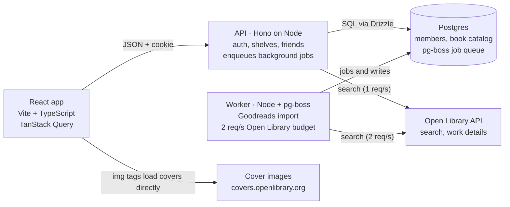

# Kindred Shelf — v1 Technical Design

> Exported 2026-11-16 from the [live technical design](https://claude.ai/artifact/TqvbzqJGNA9cvU41726wPN). If the two differ, update this file from the live doc.

Kindred Shelf v1 is a **React + TypeScript single-page app** talking to a **Node API (Hono)**. A **Node worker** handles slow jobs. One **Postgres** database holds everything, using **pg-boss** for the job queue. The whole stack is TypeScript, with one shared package of types, and the only services to run are an API, a worker and a database.

This doc covers the P0 requirements in `PRD.md`, which is the source of truth. Recommendations and favorite friends are v2 and will get their own design.

**Key decisions**

1. **One database for everything.** Postgres stores member data, the book cache and the job queue. No Redis: fewer moving parts to learn and run.
2. **Separate SPA and API** rather than a full-stack framework. The backend boundary stays explicit, which is the point of learning fullstack, and it maps directly to a future mobile app (PRD P2).
3. **Slow work runs in a worker.** Goodreads import runs as a background job, so API requests stay fast and Open Library's rate limit is enforced in one place.
4. **Ready for v2 recommendations, not built for them.** The shared catalog already stores subjects an AI model can use (descriptions can be fetched in v2), and any v2 feature must read friends' books through `visibleBooks` (below) so private books never reach a model. pgvector can be added to the same Postgres later if v2 needs embeddings.

## Stack Choices

React, TypeScript and Node were fixed from the start. Because this is a learning side project, the other picks favor one language (TypeScript), few services to run, and tools with good docs and large communities.

| Layer | Pick | Why | Alternatives not chosen |
| --- | --- | --- | --- |
| Frontend | React + TypeScript + Vite, React Router, TanStack Query | Vite is the default build tool for new single-page apps and has by far the largest community. TanStack Query handles server caching and loading states. | **Next.js:** server rendering isn't needed in v1, and a separate SPA keeps the API boundary explicit. **Parcel:** zero-config, but a much smaller community. |
| API framework | [Hono](https://hono.dev) on Node | Small and TypeScript-first, with a typed client that shares route types with the React app. | **Fastify:** equally capable and more established for large Node services; either would work. **Express:** largest community, but slower and not TypeScript-first. |
| Validation | Zod, in a shared package | One schema validates requests on the server and types the client. It's the most widely used TypeScript validation library. | **Valibot:** smaller bundles, but a smaller community and fewer integrations. |
| Database | PostgreSQL | Friends, shelves and privacy need relational joins. It also runs the job queue (pg-boss), and pgvector can be added later if v2 needs embeddings. | **SQLite:** simpler to start, but pg-boss and a hosted multi-user app both need a server database. |
| ORM / query layer | [Drizzle](https://orm.drizzle.team) | Schema in TypeScript, and queries that read like SQL, so the SQL stays visible. | **Prisma:** better docs and a larger community, but its own schema language hides more of the SQL. |
| Auth | [Better Auth](https://www.better-auth.com) | Stores users and sessions in the app's own Postgres and works with any framework. Its team has also maintained Auth.js since Sept 2025. | **Auth.js:** older and Next.js-first. **Hosted auth (Clerk):** fastest setup, but hides the auth layer this project is meant to build. |
| Job queue | [pg-boss](https://github.com/timgit/pg-boss) | Runs on the existing Postgres, so there's no Redis to run. Jobs are plain rows that can be inspected with SQL. | **BullMQ:** most popular and feature-rich, but built around Redis (Postgres support only arrived in v6, July 2026); v1 needs none of its extra features. |
| Spine colors | Fixed palette, picked by hashing the book ID | A few lines of frontend code: the same book always gets the same color, the shelf looks varied, and every palette color is chosen so spine text stays readable. No image work at all in v1. | **Colors extracted from the cover (browser canvas or sharp on the server):** spines would match their covers, but this adds image work v1 doesn't need. Deferred to v2. |
| Hosting | Render or Railway | Both run a static site, API, worker and managed Postgres from one dashboard. | **Vercel + Neon:** great for frontends, awkward for a long-running worker. **Fly.io:** more control, but more operations work. |
| Repo | pnpm workspaces: `apps/web`, `apps/api`, `packages/shared` | Shares Zod schemas and types between apps without publishing packages. | **Separate repos:** every shared type change would need publishing and syncing. |
| Testing | Vitest, Playwright | Vitest reuses Vite's config and runs every package's tests. Playwright covers end-to-end flows. | **Jest, Cypress:** mature, but need extra setup for TypeScript and ESM. |
| Local dev | Docker Compose with the `postgres` image | Same database as production, resettable in seconds. | **A cloud dev database:** slower to reset and needs a network connection. |

## Architecture

The browser only talks to the API, except for cover images, which it loads straight from Open Library. The worker shares the database with the API: jobs are rows in Postgres, so there is no extra queue service to run.

## Data Model

There are two kinds of table. **Member tables** are always queried with the current user's ID. The **book catalog** is shared: there is one row per Open Library work, reused by every member, so API calls and storage grow with the number of books rather than the number of members. Better Auth creates its own `user`, `session`, `account` and `verification` tables.

| Table | Key fields | Notes |
| --- | --- | --- |
| `profile` | `user_id` PK, `username` unique, `display_name`, `onboarded_at`, `last_active_at` | Public handle for friend requests. The two timestamps feed the PRD's onboarding and weekly-active metrics |
| `invite` | `code` PK, `created_by`, `used_by`, `expires_at` | Sign-up codes only. Sign-up requires a valid, unused code while `INVITE_ONLY=true` |
| `friend_invite` | `token` PK (random, 32+ bytes), `created_by`, `used_by`, `expires_at` | Friend invite links. Single use, expire after 7 days. Using one creates a **pending** request from the link's creator, which the person who opened it still has to accept |
| `work` | `ol_key` PK (e.g. `OL45804W`), `title`, `authors[]`, `first_publish_year`, `page_count`, `subjects[]`, `cover_id`, `fetched_at` | The shared catalog. Written **only from the server's own Open Library responses**, never from fields a client sends. `cover_id` is null when there's no cover; then the frontend draws a generated cover |
| `book_match` | `kind` (`isbn` / `goodreads_id`), `value`, `work_ol_key`, `source` (`auto` / `manual`) | PK (`kind`, `value`). Remembers every resolved match, including manual fixes, so re-imports and other members skip Open Library |
| `search_cache` | `query_key` PK (normalized query + params), `response` (jsonb), `expires_at` | 24-hour cache for `GET /books/search` |
| `user_book` | `user_id`, `work_ol_key`, `shelf` (`reading` / `read` / `want`), `rating` (1–5, nullable), `started_at`, `finished_at`, `is_private`, `source` (`manual` / `goodreads`) | **Unique (`user_id`, `work_ol_key`)**, so a book sits on exactly one shelf. Import inserts with `ON CONFLICT DO NOTHING`, so it never overwrites an existing row (see Goodreads import) |
| `friendship` | `user_low`, `user_high`, `status` (`pending` / `accepted`), `requested_by` | PK (`user_low`, `user_high`) with `CHECK (user_low < user_high)`, so A–B and B–A can't both exist. `requested_by` is set once and never updated. Delete the row to decline, cancel or remove |
| `import_job` | `id`, `user_id`, `status` (`queued` / `running` / `done` / `failed`), `total`, `matched`, `unmatched`, `created_at` | At most one active job per user (partial unique index on `user_id` where status is `queued` or `running`). The frontend polls this to show progress |
| `import_row` | `job_id`, `row_number`, `goodreads_book_id`, `title`, `author`, `isbn10`, `isbn13`, `shelf`, `rating`, `date_read`, `date_added`, `status` (`pending` / `matched` / `unmatched` / `fixed`), `work_ol_key` | Only the columns the import needs: Goodreads reviews and private notes are never stored. `pending` rows let a crashed job resume. Unmatched rows stay for manual fixing |

**Indexes to add from day one:** `user_book (user_id, shelf)`, `user_book (work_ol_key)`, `friendship (user_high)`, `import_row (job_id, status)`, and the partial unique index on `import_job`.

## API

JSON over HTTPS, with cookie sessions from Better Auth. Every route except `/auth/*` needs a session, and **the acting user always comes from the session, never from a request parameter**. Request and response bodies are Zod schemas in `packages/shared`.

**One site for app and API.** The frontend and API share a registrable domain (e.g. `app.example.com` and `api.example.com`, or the static site proxying `/api`), so the session cookie is first-party and Safari doesn't block it. The cookie is `HttpOnly`, `Secure`, `SameSite=Lax`. The API allows CORS with credentials only from the app's origin, and Better Auth's trusted origins list only that origin.

| Area | Endpoints | PRD |
| --- | --- | --- |
| Auth | `/auth/*` (Better Auth handler; sign-up checks the invite code) · `POST /invites` (create a sign-up code) | P0-1 |
| Search | `GET /books/search?q=` → Open Library results, cached 24 h in `search_cache` | P0-2 |
| Shelves | `GET /me/books?shelf=` · `PUT /me/books/:olKey` (shelf, rating, dates, private) · `DELETE /me/books/:olKey` | P0-2 |
| Import | `POST /imports` (CSV upload, max 5 MB) → `{jobId}` · `GET /imports/:id` (progress + unmatched rows) · `POST /imports/:id/rows/:n/fix` (pick the right work) | P0-3 |
| Bookshelf | `GET /users/:username/shelf` (own, or a friend's through `visibleBooks`) | P0-4, P0-5 |
| Friends | `POST /friends/requests` (by username) · `GET /friends/requests` (incoming and outgoing) · `POST /friends/:userId/accept` · `DELETE /friends/:userId` (decline, cancel or remove) · `GET /friends` · `POST /friend-invites` → link · `POST /friend-invites/:token/use` | P0-5 |
| Account | `GET /me/export` (CSV) · `DELETE /me` | Foundations |

**Ownership rules on every route:**

- `PUT /me/books/:olKey` takes only the work key from the client. If the work isn't in the catalog yet, the server fetches its fields from Open Library (or the search cache) itself.
- `POST /friends/:userId/accept` succeeds only for a pending row where the caller is in the pair **and** `requested_by` is the other user. A requester can never accept their own request.
- `GET /imports/:id` and the row-fix route check `import_job.user_id` = caller.
- `POST /friend-invites/:token/use` rejects expired, used or self-created tokens.

**Errors:** `{ error: { code, message } }` with standard status codes: 400 validation, 401 no session, 404 not found or not allowed. An unknown username, a non-friend's shelf and someone else's import all return the **same** 404 body, so the response never reveals whether something exists. Shelf and friend responses send `Cache-Control: no-store`.

## Key Flows

### Goodreads import (P0-3)

1. **Upload.** The API parses the CSV with a real CSV parser (titles contain commas and quotes), checks the Goodreads columns, and refuses files over 5 MB or with a job already active for this user. It stores one `pending` `import_row` per book with only the needed columns, creates the `import_job` and enqueues `import.run`.
2. **Clean each row.** Strip Goodreads' `="…"` wrapper from ISBNs. Map shelves: `read`, `currently-reading`, `to-read`; custom shelves fall back to each row's exclusive shelf. Rating `0` means unrated, so store null.
3. **Check remembered matches first.** Look up the row's ISBNs and Goodreads Book ID in `book_match`. A hit needs no Open Library call, which makes re-imports and books other members already imported almost free.
4. **Batched ISBN lookup.** For the rest, query search.json with about 20 ISBNs per request (OR'd together, with `limit` set and only the needed `fields`). Map results back to rows by **intersecting each result's `isbn` list with the row's ISBN-10 and ISBN-13**, never by result order.
5. **Title + author fallback**, one request per row, for rows still unmatched. Expect many: Kindle and audiobook rows often have no ISBN. Normalize the title (drop series suffixes like "(Series, #1)" and subtitles after a colon, lowercase, strip punctuation). Accept a result only when the normalized title matches **and** the author's last name appears in `author_name`; otherwise mark the row `unmatched`. A wrong book on the shelf is worse than an unmatched one.
6. **Write.** For each match, upsert the `work` from the Open Library response, record the match in `book_match`, and insert the `user_book` with `ON CONFLICT DO NOTHING`: **re-import never overwrites a book already on the shelf**, so in-app ratings, shelves and `is_private` survive. When two rows in one file map to the same work (two editions), keep one: the more advanced shelf (read over reading over want), its rating and dates.
7. **Progress and resume.** The worker processes rows in chunks of about 50, committing each chunk and updating the job counters, so a crash or restart resumes from the remaining `pending` rows. pg-boss's job expiry is set longer than the slowest expected import. The React app polls `GET /imports/:id` every 2 s with TanStack Query and shows progress; when the job finishes, it goes to the bookshelf with unmatched rows listed for fixing.
8. **Manual fix.** Fixing a row stores the chosen work in `book_match` with `source = manual`, so the next re-import keeps the fix.

Every search.json query asks only for the fields it needs (`key, title, author_name, first_publish_year, cover_i, number_of_pages_median, subject, isbn`), never `fields=*`.

### Adding a book (P0-2)

Search hits Open Library through the API, so the cache, rate limit and `User-Agent` live on the server. Picking a result sends only its work key. The server fills the `work` from its own cached search response (or fetches it), then inserts the `user_book` in one transaction, and the book appears on the shelf straight away.

## Privacy, Open Library Client and Errors

**Privacy is enforced in one module.** `apps/api/src/books/access.ts` is the only code that reads `user_book`, and it exports two functions:

- `myBooks(userId)`: all of the caller's own books.
- `visibleBooks(viewerId, ownerId)`: the owner's books where `is_private = false`, only if an accepted `friendship` row exists for the pair; everything if viewer = owner; otherwise nothing.

Rules that keep it closed:

- `viewerId` always comes from the session, never from the URL or body.
- **Counts go through the same functions.** A friend's shelf count, or book counts in `GET /friends`, are counted from `visibleBooks`, so a total never reveals that private books exist.
- No other query over other people's books in v1. "Friends who read this" on the book view is not in the PRD and is left out; if it's added later, it must call `visibleBooks` for each friend.
- Friendship checks read the `status` column at request time, so removing a friend or declining a request takes effect on the very next request.
- A lint rule (or a test that greps the codebase) fails the build if any file outside `access.ts` queries `user_book` for a user other than the session user.

**Open Library client** (`apps/api/src/openLibrary.ts`), used by both the API and the worker:

- Sends `User-Agent: KindredShelf/1.0 (<contact email>)` on every request.
- Stays under Open Library's 3 req/s across **both processes**: the API and the worker run separate limiters, so each gets a fixed budget (worker 2 req/s, API 1 req/s for live search). The worker runs one import at a time. Search responses are cached in `search_cache` for 24 h; work details live in `work`.
- Builds cover URLs from `cover_id` (`covers.openlibrary.org/b/id/{id}-M.jpg?default=false`), never from ISBN.
- On a 5xx or timeout it retries with backoff for jobs, but fails fast for live search: the UI shows a retry message, and shelves still load from the database.
- Validates every response with Zod and tolerates missing fields: Open Library says its search schema isn't guaranteed to be stable.
- The app footer carries a courtesy link to Open Library, as the Covers API asks.

**Secrets** (Open Library contact email, database URL, auth secret) live in environment variables on the host, never in the frontend bundle.

## Testing

| What | How |
| --- | --- |
| Privacy (the PRD guardrail: zero leaks) | API tests with seeded users run on every commit. A stranger, a pending friend, an accepted friend and a removed friend each request a shelf with private books and its counts. Also: a requester tries to accept their own request; a user opens another user's import job and row-fix route; an unknown username and a non-friend get identical 404s; a private book stays private after the same CSV is re-imported; an expired or used friend invite token is rejected |
| Import matching | Unit tests on a fixture Goodreads CSV: ISBN cleanup, commas and quotes in titles, rating 0 as unrated, custom shelves, batch results mapped by ISBN intersection, series-suffix normalization, a wrong-author result rejected, two editions of one work merged, re-import creates no duplicates and changes no existing row, a killed job resumes from `pending` rows |
| Key flows | Playwright: sign up with an invite → import → see shelf → open a book |

## Build Plan

Frontend first against a mocked API, then the backend, then connect the two. **The contract comes first:** the Zod request and response schemas in `packages/shared` (see API) are written before either side, so the mocks and the real API return the same shapes and swapping one for the other doesn't change any frontend code.

1. **Frontend with mocks (P0-1 to P0-5 UI):** monorepo and `packages/shared` schemas; the Vite app with React Router and TanStack Query; [MSW](https://mswjs.io) (Mock Service Worker) handlers that intercept API calls in the browser and return fixture data built from the shared schemas. Build every screen against the mocks: sign-up and Goodreads import onboarding (a mock import that simulates progress and unmatched rows), search, shelves and ratings, the bookshelf view (palette spines, generated covers, open-book view, phone layout), and friends (requests, a friend's shelf, private books hidden). *Ends with a clickable app on fake data.*
2. **Backend:** Docker Postgres, Drizzle schema and migrations, Better Auth with invite codes, Hono routes that implement the shared schemas, the Open Library client, the pg-boss worker for Goodreads import, `visibleBooks`, and the API and privacy test suites. Deploy the API, worker and database. *Ends with a tested API.*
3. **Connect:** turn off MSW one area at a time (auth, import, shelves, friends) and point the app at the real API; fix any gaps between the mocks and real data (missing covers, slow imports, Open Library errors); add the Playwright end-to-end flows and deploy the frontend. *This completes v1.*

## Open Questions

| Question | When |
| --- | --- |
| Render or Railway? Compare pricing for a small Postgres plus one worker, and confirm both apps can share one domain | Build stage 2 |
| Does search.json accept several ISBNs OR'd in one query, and can it search by Goodreads Book ID? Neither is in Open Library's API docs: test with a few rows. If not, fall back to one search per ISBN at the worker's 2 req/s | Build stage 2, before the import worker |
| What job expiry does pg-boss allow, and how long does a 500-book import take? Set the expiry above the measured time | Build stage 2 |

Cover-matched spine colors are v2. For that decision: a test on 2026-11-16 showed browsers can currently read Open Library cover pixels (no CORS block), but Open Library doesn't document this.

## Sources

- [Open Library Search API](https://openlibrary.org/dev/docs/api/search) · [Covers API](https://openlibrary.org/dev/docs/api/covers) · [Usage guidelines](https://openlibrary.org/developers/api)
- [Hono vs Express vs Fastify 2026 (PkgPulse)](https://www.pkgpulse.com/guides/hono-vs-express-vs-fastify-2026)
- [Drizzle vs Prisma, Nov 2026 (Makerkit)](https://makerkit.dev/blog/tutorials/drizzle-vs-prisma)
- [Better Auth profile (Start With Identity)](https://startwithidentity.com/vendors/open-source/better-auth.md)
- [BullMQ vs Bee-Queue vs pg-boss 2026 (PkgPulse)](https://www.pkgpulse.com/guides/bullmq-vs-bee-queue-vs-pg-boss-job-queues-nodejs-2026)
- [Railway vs Render vs Fly.io 2026 (PkgPulse)](https://www.pkgpulse.com/guides/railway-vs-render-vs-fly-io-app-hosting-platforms-2026)
